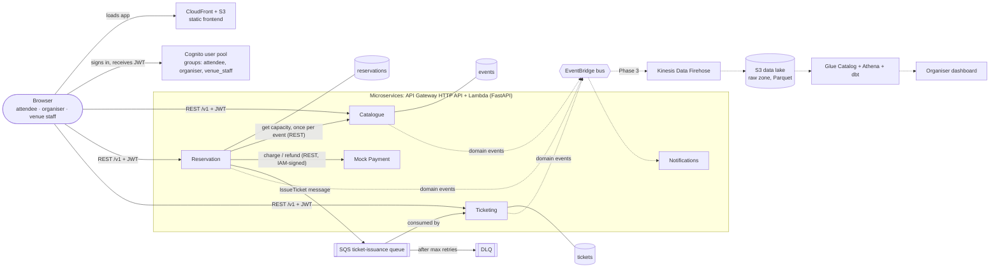
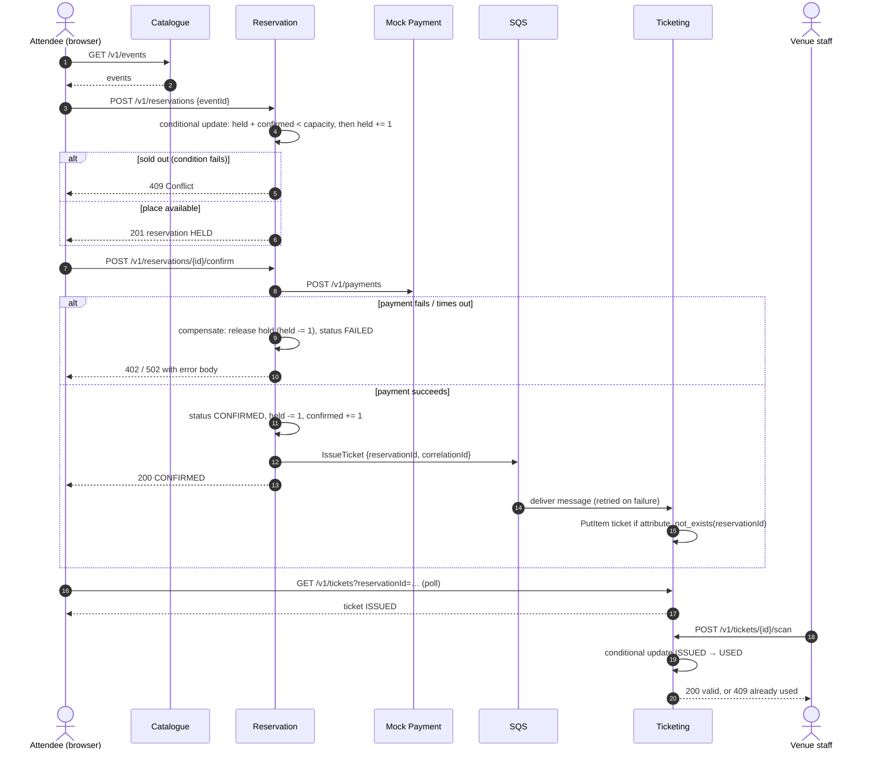

# Tessera architecture

This document describes the target architecture. Each phase fills in more of it; parts not
yet built are marked with their phase.

## 1. System overview

Solid lines are synchronous calls or owned storage. Dashed lines are asynchronous domain events.

### Components

| Component | AWS service | Why |
|---|---|---|
| Frontend | S3 + CloudFront | Static files served from a CDN over HTTPS; no servers to run. |
| Identity | Cognito user pool | Managed sign-up/sign-in that issues signed JWTs containing the user's groups. |
| API entry | API Gateway **HTTP API** | Cheaper and simpler than REST API; has a built-in **JWT authorizer** that rejects invalid/expired tokens before Lambda is invoked. |
| Compute | Lambda (Python 3.12) | Pay-per-request, scales to zero. FastAPI runs inside it via the **Mangum** adapter, so the same app also runs locally with `uvicorn`. |
| Operational data | DynamoDB, one table per service | Single-digit-ms key-value access, conditional writes for correctness, PITR backups, on-demand billing. |
| Work queue | SQS + dead-letter queue | Moves slow/fallible work (ticket issuance) off the request path, with automatic retries. |
| Domain events | EventBridge | Fan-out of "something happened" facts to any number of consumers without the producer knowing them. |
| Analytics (Phase 3) | Firehose → S3 → Glue → Athena → dbt | Serverless lake: pay per GB scanned, SQL over Parquet. |

## 2. Service boundaries

**Rule: no service reads another service's table.** A service's table is private
implementation detail; other services see it only through its REST API or the events it
publishes. This lets each service change its data model, deploy and scale independently.

| Service | Owns | Talks to |
|---|---|---|
| Catalogue | events, venues, capacity definitions | publishes `EventCreated` |
| Reservation | holds, reservations, per-event capacity counters, waitlist | calls Catalogue (capacity), Mock Payment; sends to SQS; publishes `HoldPlaced`, `ReservationConfirmed`, … |
| Ticketing | tickets, scan state | consumes SQS; publishes `TicketIssued`, `TicketScanned`, … |
| Mock Payment | nothing persistent | called by Reservation |
| Notifications | nothing persistent (dedupe store only) | consumes EventBridge events |

Note that **capacity *definition*** (how many places an event has) belongs to Catalogue, while
**capacity *consumption*** (`held`, `confirmed` counters) belongs to Reservation. The counter
must sit in the same table as the reservations so one service can update it atomically.
Reservation creates the counter on the first reservation for an event, by fetching the
capacity from Catalogue's API once ([ADR 0003](adr/0003-capacity-counter-initialisation.md)).

## 3. Main flow (Phase 1)

## 4. Correctness rules

These are the places where a distributed system goes wrong. Each one maps to a
DynamoDB **condition expression**: a rule DynamoDB checks *atomically* as part of a write. If
the rule is false, the write is rejected with `ConditionalCheckFailedException` and nothing
changes. Because the check and the write happen together on the server, two concurrent
requests cannot both pass.

| Problem | Guard | Result on violation |
|---|---|---|
| Overselling the last place | `UpdateItem` counter with `held + confirmed < capacity` | `409 Conflict` |
| Duplicate ticket when SQS redelivers a message | `PutItem` with `attribute_not_exists(reservationId)` | treat as success (already issued) |
| Double entry at the door | `UpdateItem` with `status = ISSUED` → set `USED` | `409 Conflict` |
| Payment fails after a hold was placed | Compensation: release the hold and mark the reservation failed | error to client, capacity restored |
| Duplicate domain events | Consumers dedupe on envelope `eventId` | event ignored |

## 5. Security model

1. The browser signs in with Cognito and receives an **ID/access token (JWT)**. The token
   contains `sub` (stable user ID) and `cognito:groups`.
2. **API Gateway's JWT authorizer** checks the token's signature, issuer, audience and expiry.
   Invalid tokens get `401` without invoking Lambda.
3. **The service enforces roles and ownership.** It checks group membership (e.g. only
   `venue_staff` may scan) and that the caller owns the resource (an attendee's `sub` must
   match `reservation.userId`). A failure here returns `403`. The gateway can't do this part,
   because only the service knows who owns a record.
4. Lambdas get **least-privilege IAM roles**: each function may access only its own table,
   queue and bus.
5. **Service-to-service calls:** Reservation → Catalogue forwards the caller's JWT (a read any
   signed-in user may do). Reservation → Mock Payment uses an IAM-authorised route, and
   Reservation signs requests with SigV4. Only Reservation's role may invoke it
   ([ADR 0004](adr/0004-mock-payment-iam-auth.md)).

## 6. Cross-cutting conventions

- **Versioned routes:** `/v1/...`; each service publishes an `openapi.yaml`.
- **Error body:** `{"error": {"code": "...", "message": "...", "correlationId": "..."}}`.
- **Correlation ID:** `X-Correlation-Id` is generated at the edge if missing, then propagated
  via HTTP headers, SQS message attributes and event envelopes. It appears in every JSON log line.
- **Event envelope:** `{eventId, eventType, version, occurredAt, correlationId, data}`.
- **Health checks:** `GET /v1/health` on every HTTP service.
- **Resilience:** timeouts and bounded retries with backoff on every outbound HTTP call; SQS
  DLQ for poison messages; at least one CloudWatch alarm (e.g. DLQ depth > 0).
- **Privacy:** synthetic user IDs only; no names or emails in logs or the lake.

## 7. Deployment

- One **SAM** stack per service (`services/<name>/template.yaml`). SAM is a CloudFormation
  extension: you describe functions, APIs and tables in YAML, and `sam deploy` creates them.
- Shared resources (Cognito user pool, EventBridge bus) live in the shared stack
  `infra/shared/template.yaml` (`tessera-<env>-shared`). It's deployed first, and it publishes
  IDs and ARNs to SSM Parameter Store under `/tessera/<env>/...` for service stacks to read
  ([ADR 0002](adr/0002-shared-platform-stack.md)).
- Frontend is uploaded to S3 and served via CloudFront.

## 8. Architecture decisions

Decisions are recorded as ADRs in [docs/adr/](adr/):

| ADR | Decision |
|---|---|
| [0001](adr/0001-serverless-microservices-per-service-stack.md) | Serverless microservices: Lambda + HTTP API, one SAM stack and one DynamoDB table per service |
| [0002](adr/0002-shared-platform-stack.md) | Shared resources (Cognito, EventBridge bus) in `infra/shared/`; outputs published via SSM Parameter Store |
| [0003](adr/0003-capacity-counter-initialisation.md) | Reservation creates each event's capacity counter on first reservation, fetching capacity from Catalogue once |
| [0004](adr/0004-mock-payment-iam-auth.md) | Mock Payment is an internal HTTP API protected by IAM; Reservation signs requests with SigV4 |
